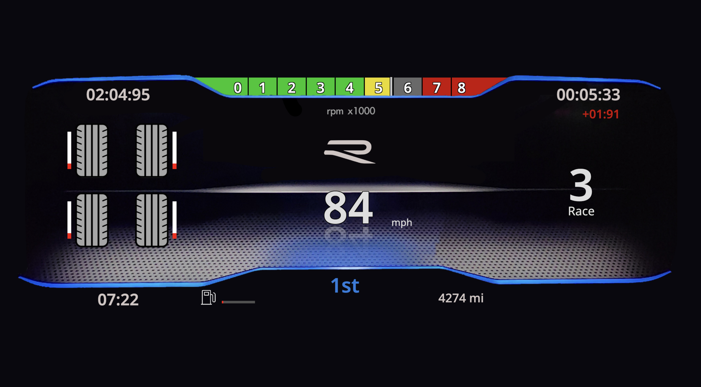

# Sim-Dash

A customizable telemetry dashboard system for racing and rally simulation games. Features multiple dash styles (Golf R, Rally, TCR), real-time telemetry visualization, timing splits, and per-car odometers.

<div align="center">
   
</div>

---

## Supported Games

### Forza
- **Forza Motorsport**
- **Forza Horizon 5**
- **Forza Motorsport 7**
- **Forza Horizon 4**

### Rally
- **EA WRC**
- **Dirt Rally 2.0**
- **Dirt Rally**

### Assetto Corsa
- **Assetto Corsa**
- **Assetto Corsa Competizione**

---

## Setup

### Overview

- **Server Setup**: Get the Docker container running.
- **Dash Setup**: Learn how to access and configure the dashboard.
- **Forza Setup**: Configure the game to stream telemetry data.

---

<details>
<summary>Server Setup</summary>

### Requirements

- **Docker** must be installed on your system.

### Usage

#### 1. Build and Start the Container
```bash
./docker.sh start
```
- This command builds the `sim-telemetry` Docker image and starts the container.
- To start the container each time the computer starts, use `./docker.sh daemon`.

---

### Configuration

#### Docker Variables
- **`IMAGENAME`**: Name of the Docker image (`sim-telemetry`).
- **`CONTAINERNAME`**: Name of the Docker container (`sim-telemetry-container`).

#### Ports
The container uses the host network. These ports are on the host:
- **`3000`** (TCP): The web pages.
- **`8888`** (TCP): The live telemetry data and the autocross recorder.
- **`9999`** (UDP): The telemetry from the game. You can set a different port with the **Sim Hub** button.

### Script Details
- **`./docker.sh start`**: Builds and starts the container.
- **`./docker.sh daemon`**: Builds and starts the container. The container starts again when the computer starts.
- **`./docker.sh stop`**: Stops and removes the container.
- **`./docker.sh restart`**: Stops the container, then builds and starts it again.
- **`./docker.sh log`**: Shows the container log.
- **`./docker.sh help`**: Shows the commands.

</details>

---

<details>
<summary>Dash Setup</summary>

### Accessing the Dashboard and Game Selection

1. **Game Selection**:
   - Open a web browser and go to `http://<IP>:3000` (replace `<IP>` with the actual IP address of the machine running the Docker container).
   - This page allows you to select the game you want to use with the telemetry system.

2. **Dashboard Gauge Cluster**:
   - Access the telemetry dashboard at `http://<IP>:3000/dash`.
   - This page displays real-time telemetry data in your selected dash style.

#### Game Selection

- Games are organized by category (Forza, Rally, Assetto Corsa)
- Click a category to expand and see available games
- Click a game to start telemetry streaming
- Games are dynamically loaded from `web-server/data/games.json` for easy configuration

#### Configuration Options

**Config Button** - Opens configuration modal:
- **Dash Style**: Choose between Golf R, Rally, or TCR dash layouts
- **Shift Light Type**: Off, Left-Right, or Outside-In patterns
- **Split Type**: Class, Car, or Session-based timing splits

**Sim Hub Button** - Opens the port configuration:
- **Use Custom Port**: Turn on to use a port that is not the default port (9999).
- **Port Number**: The UDP port for the game telemetry (1024-65535).
- **Sim Hub Dash URL**: The address of a Sim Hub dash.

**Stop Button** - Halts the telemetry process and resets the dashboard

#### Dashboard Scaling and Positioning

- Click **"Scale Dash"** to open the scaling and position adjustment interface.
- **Adjusting Settings**:
  - **Scale Up**: Increase dashboard size.
  - **Scale Down**: Decrease dashboard size.
  - **Move Up**: Shift dashboard upward.
  - **Move Down**: Shift dashboard downward.

#### Saving Dashboard Layouts

- After making adjustments:
  - Enter a name for your layout in the input field.
  - Click **Save** to store the layout.
- Layouts are saved server-side and can be loaded later.

#### Loading Saved Layouts

- When clicking **"Scale Dash"**, you'll see a list of available layouts.
- Select a layout to apply it, or choose "Custom" to define a new layout.


</details>

---

<details>
<summary>Autocross</summary>

### Autocross Analyzer

The autocross analyzer records Assetto Corsa runs. It shows the runs on a track map, on charts and in sector tables.

1. Open `http://<IP>:3000/autocross`.
2. Click **Start**. The recorder is armed.
3. Drive the course. Each run starts when the game timer starts. Each run stops when the game timer stops.
4. The run shows in the **Runs** list. Select runs to compare them.

#### Recorded Data
- The recorder keeps the launch before the start line. Times before the start line are negative.
- Time `0` is the start line. The last sample is the finish line.
- The recorder keeps a maximum of 50 samples each second.

#### Install as an App
The web page can operate as an app on a tablet. The browser installs an app only from a secure address.
- **Android (Chrome)**: Open `chrome://flags/#unsafely-treat-insecure-origin-as-secure`. Add `http://<IP>:3000` and enable the flag. Then open the page and select **Install app**.
- **iPad (Safari)**: Open the page, then select **Share > Add to Home Screen**.

</details>

---

<details>
<summary>Game Setup</summary>

### Forza (Motorsport/Horizon)

1. **Open Forza** on your gaming platform
2. Navigate to **Settings > HUD and Gameplay**
3. Locate **Data Out** or **UDP Telemetry** settings
4. Set **IP address** to the machine running the Docker container
5. Set **Port** to `9999` (or your custom port)

### Dirt Rally / Dirt Rally 2.0 / EA WRC

1. **Navigate to game installation directory**
2. Find `hardware_settings_config.xml` (usually in Documents/My Games/)
3. Configure UDP settings:
   ```xml
   <udp enabled="true" extradata="3" ip="127.0.0.1" port="9999" delay="1" />
   ```
4. Replace IP with your Docker host machine IP
5. Set `extradata="3"`. Dirt Rally and Dirt Rally 2.0 send the full telemetry packet only with this value.

### Assetto Corsa

Assetto Corsa sends telemetry through the SimDash UDP app. The app is in `ac-plugin/`.

1. Install the app. Use one of these procedures:
   - Drag `ac-plugin/SimDashUDP.zip` into Content Manager.
   - Copy the folder `ac-plugin/SimDashUDP` to `<AC root>\apps\python\`.
2. Start Assetto Corsa. Go to **Options > General > Apps** and enable **SimDash UDP**.
3. In the **SimDash UDP** window, set the IP address of the Docker host.
4. Set the same UDP port in the app and on the SimDash server:
   - The app sends to port `20778` by default.
   - On the game selection page, click **Sim Hub**. Turn on **Use Custom Port** and set `20778`.
5. Select **Assetto Corsa** on the game selection page.

For more data about the app, refer to `ac-plugin/README.md`.

### Assetto Corsa Competizione

1. Navigate to game installation folder
2. Edit broadcasting configuration
3. Configure UDP output to Docker host IP and port

---

### Adding New Games

Games are configured in `web-server/data/games.json`:

```json
{
  "categories": [
    {
      "name": "Category Name",
      "games": [
        {
          "name": "Display Name",
          "id": "GAMECODE"
        }
      ]
    }
  ]
}
```

The `id` field is the game code that serves as the prefix for the packet format file.

**Example:** If `"id": "FM"`, create the packet format file at:
- `telemetry/packets/FM_packetformat.dat`

This file defines the UDP packet structure for the game's telemetry data.

</details>
